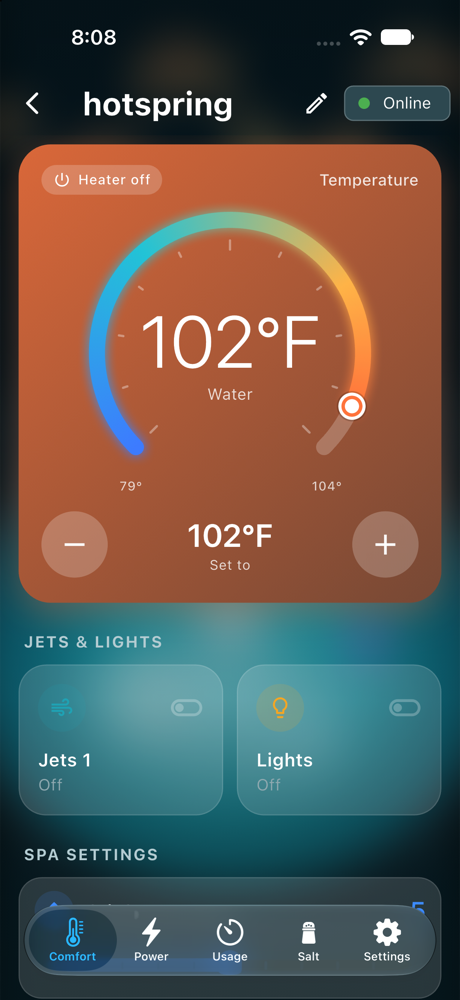
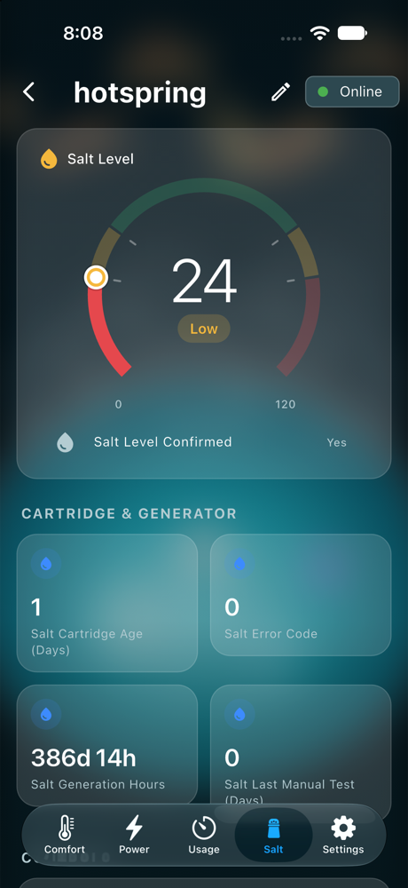
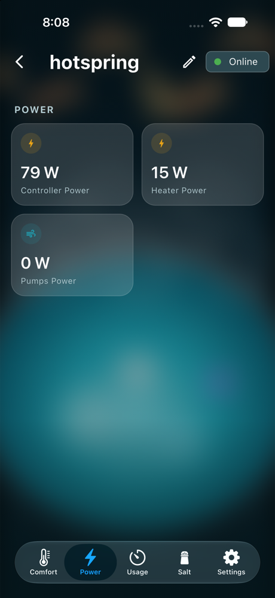

# ESP-IQ2020: IQ2020 Spa Apps, Watches & Web UI

This is a fork of [Ylianst/ESP-IQ2020](https://github.com/Ylianst/ESP-IQ2020). It adds **IQ2020 Spa** apps for iPhone, iPad, Android, Apple Watch, and Wear OS — plus a self-contained on-device Web UI and persistent ESP32 history — to control an IQ2020 hot tub **directly** over local Wi-Fi or optional remote HTTPS, with no Home Assistant and no cloud account.

```
Spa IQ2020 board ──RS485── ESP32 (ESPHome + iq2020)
                              ├─► Local Wi-Fi (TCP 6053, Noise PSK) ──► Phone, Tablet & Wear OS apps
                              ├─► On-device Web UI (HTTP 80) ──────────► Any browser / optional Cloudflare Tunnel + Access (HTTPS)
                              └─► iPhone WatchConnectivity relay ──────► Apple Watch app
```

Home Assistant was only ever one client of ESPHome's native API. The app and web UI talk to the same ESP32 and the same entities, so anything Home Assistant could control, they can too.

<p align="center">
  
  
  
</p>

## What this fork adds (`v1.1.0`)

- **Phone & Tablet App ([`app/`](app/), Flutter — iOS, iPadOS & Android):**
  - **Comfort Controls:** temperature dial with −/+ set point, live **heating ETA** (ESP32-calibrated rate of rise), **ESP32-stored global temperature presets** synced across phone, watches, and web UI, jets, lights (including logo/color LEDs), and dynamic entity discovery (°F/°C, salt, Coolzone, audio).
  - **Freshwater Salt & IQ Tab:** zoned radial salt gauge, salt output level, boost, cartridge status/reset, and Freshwater IQ pH/chlorine readings when equipped.
  - **Power & Energy Tab:** live controller, heater, and pump watts, voltage, current, daily & cumulative kWh, and 14-day micro-charts.
  - **2-Year History Dashboard (`Settings → History`):** backed by [`components/iq2020_history/`](components/iq2020_history/) 3-tier NVS ring-buffer storage on the ESP32 (hourly, daily, and monthly rollups persisted across reboots).
  - **System, Diagnostics & Pairing (`Settings`):** ESP32 heap/uptime/reset-reason diagnostics, **System → Reboot system** button with confirmation dialog, one-scan QR pairing for Wear OS watches, and responsive tablet / foldable navigation rail (including iPhone Duo).
  - **Zero Cloud & Privacy-First:** connection profiles, API encryption keys, and optional remote Access service tokens are stored only on your devices (iOS Keychain / Android Keystore) — see [`PRIVACY.md`](PRIVACY.md).
- **Apple Watch App ([`app/ios/IQ2020Watch/`](app/ios/IQ2020Watch/)):** bundled companion app showing water/target temperature, heating ETA, presets, jets, lights, and salt zone relayed through the iPhone.
- **Wear OS App ([`wear/`](wear/)):** standalone watch app connecting directly over Wi-Fi (reusing `app/`'s Noise/protobuf client) with one-scan QR setup from the phone app.
- **On-Device Embedded Web UI ([`components/iq2020_web/`](components/iq2020_web/)):** self-contained dark-mode web app served directly from the ESP32 at `http://<device>.local/` (Comfort, Salt, Power, History, and Settings including Reboot system) over ESPHome `web_server` v3 REST/SSE — works locally or behind Cloudflare Tunnel + Access.
- **ESPHome Firmware & Custom Components ([`firmware/`](firmware/), [`components/iq2020_web/`](components/iq2020_web/), [`components/iq2020_history/`](components/iq2020_history/)):**
  - [`components/iq2020/`](components/iq2020/) stays compatible with upstream `Ylianst/ESP-IQ2020`.
  - [`firmware/hotspring.yaml`](firmware/hotspring.yaml) (full ESP-IDF config for M5Stack ATOM Lite + Tail485): `sram1_as_iram: true` + `flash_chip: generic` IRAM optimization, `api.reboot_timeout: 0s`, SNTP time, weekly Sunday 4:00 AM maintenance reboot with NVS history flush, `CONFIG_HTTPD_MAX_REQ_HDR_LEN: 4096` for Cloudflare Access headers, optional Noise-encrypted `fetch_remote_config`, and raw RS485 debug port (`1234`) disabled by default.
  - [`firmware/hot-tub-mobile.yaml`](firmware/hot-tub-mobile.yaml): minimal Home Assistant-free starter config.

## Installation & Setup

### 1. Flash the ESP32 Firmware

Choose [`firmware/hotspring.yaml`](firmware/hotspring.yaml) for the full feature set (Web UI, 2-year NVS history, global presets, heating ETA, Freshwater Salt/IQ) or [`firmware/hot-tub-mobile.yaml`](firmware/hot-tub-mobile.yaml) for a minimal setup:

1. Copy [`firmware/secrets.example.yaml`](firmware/secrets.example.yaml) to `firmware/secrets.yaml` (git-ignored), or enter the corresponding secrets in ESPHome Device Builder (`⋮` → Secrets).
2. Generate a 32-byte base64 Noise API key:
   ```bash
   openssl rand -base64 32
   ```
3. Update Wi-Fi credentials, timezone, and Celsius entries (`_c_temperature` / `celsius: true`) if needed, then build and flash (USB-C for first install, OTA afterwards):
   ```bash
   esphome run firmware/hotspring.yaml
   ```

### 2. Install the Mobile & Watch Apps

- **Android & Wear OS (Google Play Internal Testing):** Join the tester track at https://play.google.com/apps/internaltest/4699945925693455410, install **IQ2020 Spa** on your phone (and Wear OS watch if applicable), then pair the watch via **Settings → Set up watch** QR scan.
- **iOS, iPadOS & Apple Watch:** Install **IQ2020 Spa** via TestFlight / the App Store (the Apple Watch companion installs automatically through the Watch app on iPhone).
- **Build from Source (Flutter 3.22+):**
  ```bash
  # Phone & tablet app
  cd app
  flutter pub get
  flutter test
  flutter run                     # or: flutter build ios --release / flutter build appbundle --release

  # Standalone Wear OS watch app
  cd ../wear
  flutter pub get
  flutter run                     # or: flutter build appbundle --release
  ```

### 3. Connect (Local & Optional Remote Access)

- **Local Wi-Fi:** Open **IQ2020 Spa**, select your spa under mDNS discovery (`_esphomelib._tcp`) or add its hostname/IP (`http://hotspring.local` or LAN IP), and enter your `api_encryption_key`. You can also open `http://<device>.local/` directly in any browser for the embedded Web UI.
- **Remote Access (optional):** Keep ESPHome port `6053` and HTTP port `80` private on your LAN — never port-forward them to the internet. For away-from-home access, either connect over a VPN (Tailscale / WireGuard) **or** expose the ESP32 Web UI through a **Cloudflare Tunnel + Cloudflare Access**, then set your Remote URL (e.g., `https://spa.example.com`) and optional Service Token (`CF-Access-Client-Id` / `CF-Access-Client-Secret`) in the app's hot tub settings (the app tries LAN TCP `6053` first and falls back to HTTPS automatically).

The rest of this README is the original upstream documentation for hardware compatibility, RS485 wiring, and optional Home Assistant integration.

---

# ESP-IQ2020
-- Only compatible with 2014 spas and newer, [look at the exact list here](https://github.com/Ylianst/ESP-IQ2020/blob/main/documentation/tested.md#list-of-models-compatible-with-ace-77401-controller) --

Connect your IQ2020 powered Hot Tub to Home Assistant to make your Hot Tub a lot smarter. You will be able to remotely control temperature, lights, jets, lock the spa remote, monitor power usage and more. You can graph temperature and power usage, control temperature for time-of-day electric rates or when on vacation, get notified when the tub is in use, lock the spa remote control when the house in away mode, blink the tub lights when someone rings the doorbell and more.


There is a video showing off the integration and how to get it installed.

[](https://youtu.be/egX6bspzuqo)

[Short Video (5:38)](https://www.youtube.com/watch?v=egX6bspzuqo), [Long Video (24:42)](https://youtu.be/OjBa2vJ3cmw)

The IQ2020 is the control board used by a lot of hot tubs, so check if you have this board. You will need to have [Home Assistant](https://www.home-assistant.io/) as your smart home controller and to buy a small device, flash the right firmware on the device using ESP-Home and then connect the device using 4 wires to your hot tub. The device will be powered by the hot tub and has built-in WIFI, so everything stays within the control box, no messy wires. First you will need to buy a ESP32 device and a RS485 interface for it. I recommand this exact hardware (~26$ US):

- [ATOM Lite ESP32 IoT Development Kit](https://shop.m5stack.com/products/atom-lite-esp32-development-kit)
- [ATOM Tail485 - RS485 Converter for ATOM](https://shop.m5stack.com/products/atom-tail485)
- [5 Colors 1Pin 2.54mm Female to Male Breadboard Jumper Wire](https://www.amazon.com/XLX-Breadboard-Soldering-Brushless-Double-end/dp/B07S839W8V/ref=sr_1_3)

You could try to [create a better cable](https://github.com/Ylianst/ESP-IQ2020/blob/main/documentation/devices.md#creating-a-correct-cable), but it's not really needed. Once you get the device, connect it to your computer using a USB-C table, create a new ESP home device, call it "Hot Tub" or anything you like, select `ESP32`. Once created, edit the configuration file to look like the one below. You should keep your own API encryption key and OTA password, but everything else can be copied from this example.

<details>
<summary>Sample ESP-Home configuration file</summary>

```yaml
esphome:
  name: hot-tub
  friendly_name: Hot Tub
  comment: "Luxury Spa"

esp32:
  board: m5stack-atom
  framework:
    type: arduino

logger:
  baud_rate: 0
  level: ERROR

# Enable Home Assistant API
api:
  encryption:
    key: "xxxxxxxxxxxxxxxxxxxxxxxxxxxxxxxx"

ota:
  - platform: esphome
    password: "xxxxxxxxxxxxxxxxxxxxxxxxxxxxxxxx"

wifi:
  ssid: !secret wifi_ssid
  password: !secret wifi_password

external_components:
  - source: github://ylianst/esp-iq2020

# Make sure tx/rx pins are correct for your device.
# GPIO26/32 is ok for M5Stack-ATOM + Tail485, look in GitHub devices link for your device.
uart:
  id: SpaConnection
  tx_pin: GPIO26
  rx_pin: GPIO32
  baud_rate: 38400

iq2020:
   uart_id: SpaConnection
   polling_rate: 65
   # A port may be configured to debug RS485 traffic as described in documentation/debugging.md.
   # port: 1234

# If using Celsius units on the hot tub remote, replace _f_ with _c_ in the three entries below.
# Feel free to remove any sensor that are not relevant for your hot tub.
sensor:
  - platform: iq2020
    current_f_temperature:
      name: Current Temperature
    target_f_temperature:
      name: Target Temperature
    outlet_f_temperature:
      name: Heater Outlet
    power_l1:
      name: Pumps Power
    power_heater:
      name: Power Heater
    power_l2:
      name: Heater Power
    pcb_f_temperature:
      name: Controller Temperature

switch:
  - platform: iq2020
    name: Lights
    id: lights_switch
    icon: "mdi:lightbulb"
    datapoint: 0
  - platform: iq2020
    name: Spa Lock
    id: spa_lock_switch
    icon: "mdi:lock"
    datapoint: 1
  - platform: iq2020
    name: Temperature Lock
    id: temp_lock_switch
    icon: "mdi:lock"
    datapoint: 2
  - platform: iq2020
    name: Clean Cycle
    id: clean_cycle_switch
    icon: "mdi:vacuum"
    datapoint: 3
  - platform: iq2020
    name: Summer Timer
    id: summer_timer_switch
    icon: "mdi:sun-clock"
    datapoint: 4

fan:
  - platform: iq2020
    name: Jets 1
    id: jets1
    icon: "mdi:turbine"
    datapoint: 0
    speeds: 1
  - platform: iq2020
    name: Jets 2
    id: jets2
    icon: "mdi:turbine"
    datapoint: 1
    speeds: 2

# Set "celsius" to "true" if using celsius units.
climate:
  - platform: iq2020
    name: Temperature
    celsius: false

text_sensor:
  - platform: iq2020
    versionstr:
      name: Version
```

</details>

You may need to make a few changes. If your hot tub is setup to display temperature in celsius, replace all `xxx_f_temperature` with `xxx_c_temperature` and set `celsius` to true in the `climate` section. Make sure you put your WIFI SSID and Password in `secrets.yaml`. Once ready, go ahead and flash your device over USB-C. At this point, the device should be visible over WIFI when powered using USB-C even if it's not connected to the computer.

Next, grab 4 breadboard jumper wires and connect them to the RS485 module. I recommand using 4 different color wires. Idealy blue, yellow, red and black. Put the male end in the RS485 module and tighten using a small screw driver. Double check the wires don't come off. Your device should look like this.


Next, power off your hot tub and connect your new device like this:


In the picture below you will notice I have the expansion board (Part #74150) attached with 8 expansion connectors, your hot tub will generally have 1 or 2 expansion connectors. If they are all busy, you will need to get an expansion board. Double check all the wires, you should not need to force anything, the wires should fit just right.


Once done, power your hot tub back on and you should see data flowing into Home Assistant. You can see the current temperature, set the target temperature, lock the remote control, turn on lights & jets and graph the temperature and power usage. The spa data is polled by the device every minute, so, if you change a setting using the tub's remote, it may take up to a minute to update on Home Assistant. If something does not work right, [please open an issue in GitHub](https://github.com/Ylianst/ESP-IQ2020/issues). As with all Home Assistant integrations, you can use automations. For example, I am on a electric time-of-day plan and so, I lower the temperature automatically a few minutes before 5pm and turn it back up at 9pm. There are also sensors provided so you can create tracking graphs.

For added features and details:
  - [More Sensors, Templates and Extras](https://github.com/Ylianst/ESP-IQ2020/blob/main/documentation/extras.md)
  - [Audio Module Emulation](https://github.com/Ylianst/ESP-IQ2020/blob/main/documentation/audio.md)
  - [ACE Module Emulation](https://github.com/Ylianst/ESP-IQ2020/blob/main/documentation/ace.md)
  - [Coolzone Heat Pump Support](https://github.com/Ylianst/ESP-IQ2020/blob/main/documentation/coolzone.md)
  - [Using different ESP32 devices](https://github.com/Ylianst/ESP-IQ2020/blob/main/documentation/devices.md)
  - [Details on the RS485 serial protocol](https://github.com/Ylianst/ESP-IQ2020/blob/main/documentation/protocol.md)
  - [Debugging RS485 traffic](https://github.com/Ylianst/ESP-IQ2020/blob/main/documentation/debugging.md)
  - [Variable Electric Rate Savings](https://github.com/Ylianst/ESP-IQ2020/blob/main/documentation/electric.md)
  - [Full configuration example](https://github.com/Ylianst/ESP-IQ2020/blob/main/documentation/configuration.md)
  - [Tested Hot Tubs](https://github.com/Ylianst/ESP-IQ2020/blob/main/documentation/tested.md)

Known Issues:
  - IQ2020 boards prior to 2014 will not work with this integration. See [Tested Hot Tubs](https://github.com/Ylianst/ESP-IQ2020/blob/main/documentation/tested.md) for details.
